# Claude Switch manual

How to use every part of Claude Switch. Also on the [website](https://ngoni-sama.github.io/claude-switch/manual.html).

- [Get started](#get-started)
- [Overview](#overview)
- [Add a profile and sign in](#add-a-profile-and-sign-in)
- [Sessions](#sessions)
- [Linked computers](#linked-computers)
- [Shared memory](#shared-memory)
- [Updates](#updates)
- [Backup & move](#backup--move)
- [Terminal](#terminal)
- [Settings](#settings)
- [Small screens, light and dark](#small-screens-light-and-dark)
- [When something looks wrong](#when-something-looks-wrong)

## Get started

Claude Switch runs several Claude Desktop accounts side by side, each in its own window, e.g. **Work** and **Personal**. It shows every account's usage and reset times, and hands a session to another account when one runs out.

1. Install [Claude Desktop](https://claude.ai/download) if you haven't, then install Claude Switch from the [download page](https://ngoni-sama.github.io/claude-switch/#install).
2. Open **Claude Switch**. Name the account Claude is already signed in to (e.g. *Personal*), then your other accounts (e.g. *Work*).
3. Each new profile opens its own Claude window. Sign in there with that profile's account. You do this once per profile.

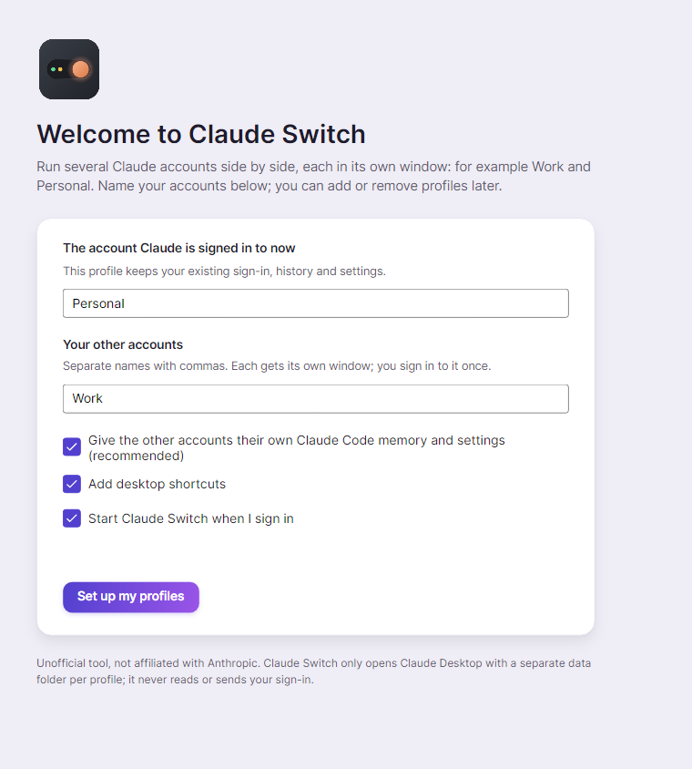

> **Tip.** Every profile needs **its own account**. Two profiles on one account would share one usage limit, so Claude Switch asks you to sign in with a different one.

## Overview

The home page. Four tiles along the top sum things up: how many profiles you have (and how many are open), which account has the **most room left**, how many Claude Code sessions there are, and which Claude version you run.

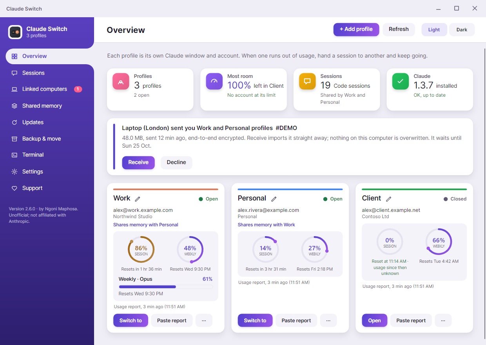

Below are **banners** for anything that needs you (a transfer waiting, an account at its limit, a profile with no account) and **one card per profile**:

- **Name and pencil.** Click the pencil (or double-click the name) to rename the profile. Its launchers and terminal command follow; nothing needs signing in again.
- **Open / Closed / Not signed in**, the account email and organisation.
- **Usage rings.** *Session* and *Weekly*, worded like Claude's own panel. **0% means all available, 100% means used up.** Reset times are under each ring.
- **Switch to / Open** brings that profile's Claude window forward or opens it. A profile with no account shows **Sign in** instead.
- **Paste report.** For exact numbers, copy the usage report in that profile's Claude window (it starts with *Claude Code usage report*) and press this. Claude Switch also notices it on its own.
- **··· (More)**: restart the window, open Claude Code in a terminal as this profile, copy MCP servers from another profile, duplicate, rename, pick a colour, open at start-up, show its folder, or remove it.

## Add a profile and sign in

1. On **Overview**, press **+ Add profile** and name it, e.g. *Client A*.
2. A Claude window opens for it straight away, with a **Sign in to Client A** window beside it.
3. Sign in in the new Claude window. The sign-in window updates by itself and turns green when it's done. Press **Done**.

<table><tr><td width="50%">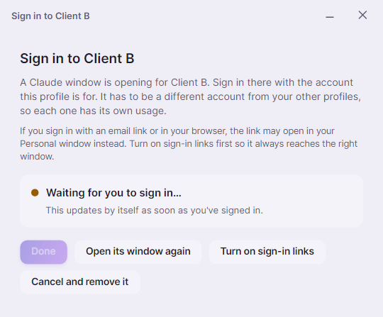</td><td width="50%">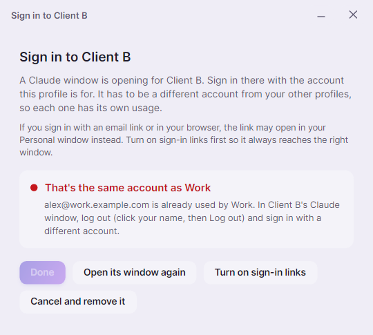</td></tr></table>

If you sign in with an account another profile already uses, it says which one and keeps **Done** greyed out. In that Claude window, click your name, choose **Log out**, and sign in with a different account.

Closing the window before signing in offers to **remove** the new profile (a profile with no account can't be used) or keep it for later. Profiles without an account, and two profiles sharing one, get a banner on Overview with a button to fix it.

> **Tip.** Signing in with an email link or in your browser? The link can open in your main Claude window instead. Press **Turn on sign-in links** first (Windows) so it always reaches the window that asked for it.

## Sessions

Claude Code conversations from each signed-in account, newest first. When an account runs out of usage, pick the session and press **Continue in Personal →** (or any other profile). The conversation is copied there and the original stays where it is.

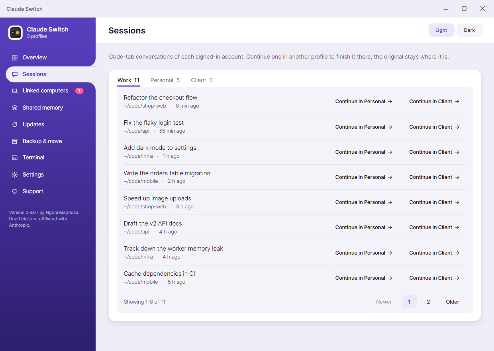

## Linked computers

Send profiles to your other computers over the internet, wherever they are: another office, another country. Transfers are **end-to-end encrypted** to the receiving computer and sign-ins never travel.

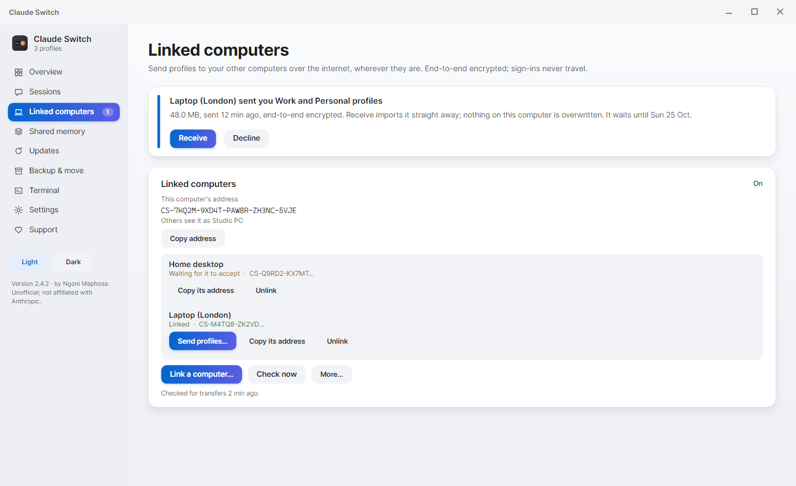

1. Press **Turn on**. This computer gets an address like `CS-7KQ2M-9XD4T-PAW8R-ZH3NC-5VJE`. Press **Copy address**.
2. On the other computer, press **Link a computer…** and paste the address. The first computer gets a request; press **Accept**. You only link once.
3. Press **Send profiles…** next to a linked computer and tick the profiles to send.
4. On the other computer, a banner appears: press **Receive**. It imports straight away; nothing there is overwritten.

Every transfer has a short **ID** like `#A1B2C3`, shown on both computers, and the **Transfers** card shows it live:

- **Speed and time left** while it uploads (e.g. *12.4 of 48 MB at 1.1 MB/s, about 30 s left*). The receiving computer sees the upload progress too.
- **Resume.** If the connection drops, the transfer is *Paused*. Press **Resume** and it carries on from the parts already sent. It also resumes when Claude Switch starts.
- **No duplicates.** Sending the same profiles again resumes or replaces the copy that's waiting, so the other computer only ever gets one.
- Closing the send window doesn't stop it: press **Hide (keeps sending)**. **Cancel** stops it and deletes it from the relay.
- A transfer waits on the relay for up to a week, so the other computer needn't be on, and is deleted once collected or declined.

> **Tip.** Update both computers to the same version of Claude Switch before sending.

## Shared memory

Let accounts share one memory and one set of conversations. When one runs out of usage, open another and carry on from exactly where you left off: same projects, same notes, same chats. Sign-ins stay separate.

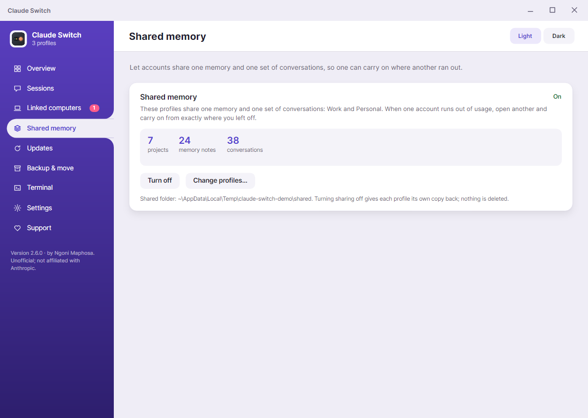

Press **Turn on sharing**, pick the profiles, and close their Claude windows while it sets up. **Turn off** gives each profile its own copy back; nothing is deleted.

## Updates

Shows every installed copy of Claude and its version, and spots the classic trap: a second, forgotten copy that stopped updating. **Restart all profiles** moves windows onto the current copy; **Check for a newer Claude** opens the updater. Choose **Tell me**, **Automatic** (opens profiles that are behind so Claude's own updater runs) or **Off**.

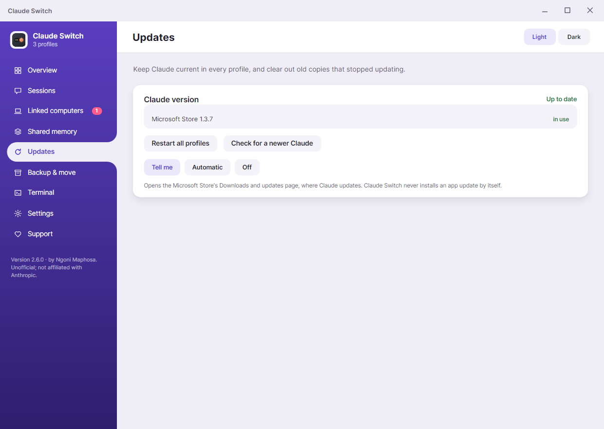

## Backup & move

**Export…** saves profiles (sessions, memory, settings) to one password-protected file; **Import…** brings them back on any computer, e.g. after a crash. Sign-ins are never exported. Or send them straight to a linked computer.

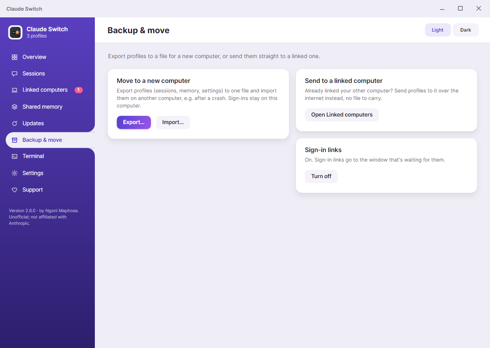

## Terminal

Run Claude Code as any profile. **Turn on terminal commands** to type `claude-work`, `claude-personal`, … in any terminal, and **Add a folder rule** so plain `claude` picks the right profile inside a project. Or use **··· > Open Claude Code in a terminal** on a profile card.

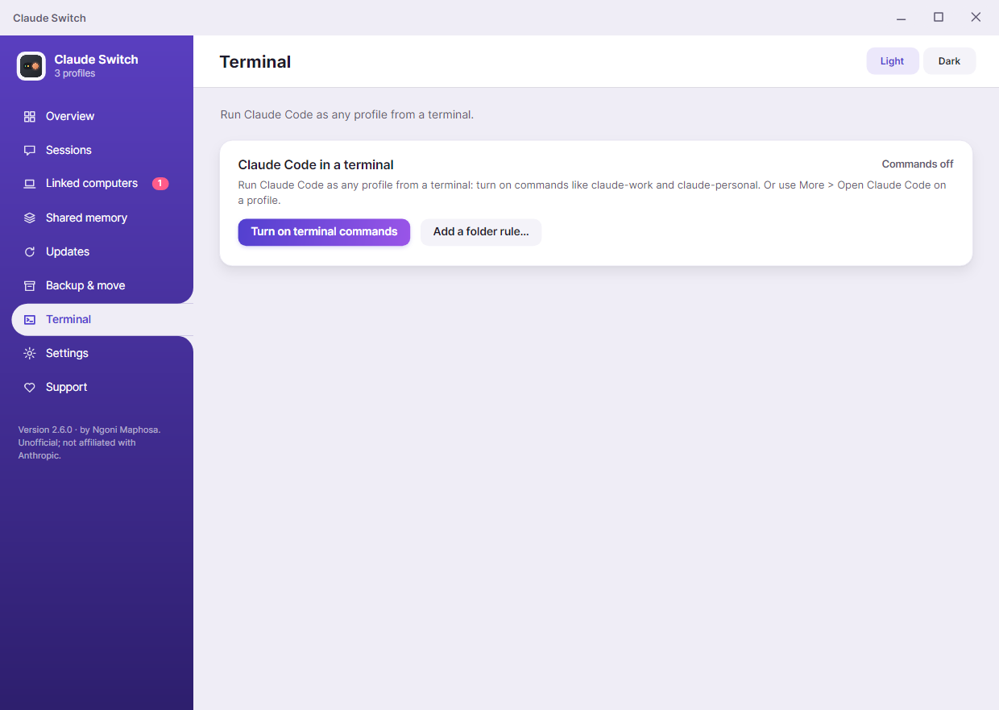

## Settings

- **Keyboard shortcuts** (Windows): Ctrl+Alt+1 to 9 open a profile; Ctrl+Alt+0 opens Claude Switch.
- **Reopen profiles when a Claude update closes them.**
- **Start Claude Switch when I sign in**, and offer to reopen the profiles you had open.
- **Claude Switch updates**: Tell me, Automatic or Off. Updates are signed and only installed if the signature and checksum match.
- **Diagnose…** writes one report: where each profile's data lives, which Claude each window runs, sign-in state and launchers, with a fix for anything wrong. Emails are masked so you can paste it into an issue.

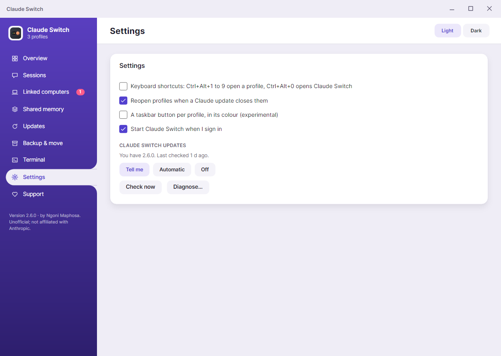

## Small screens, light and dark

On a laptop, or when the window isn't maximised, everything gets tighter. Narrower still, the sidebar shrinks to icons; hover one to see its name. Switch between **Light** and **Dark** at the top right of any page.

<table><tr><td width="50%">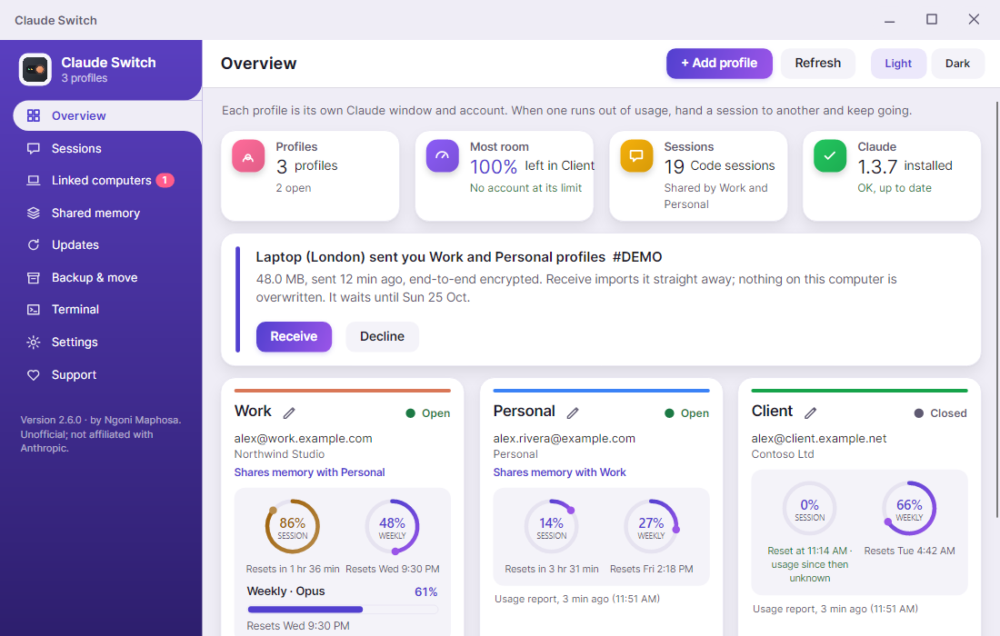</td><td width="50%">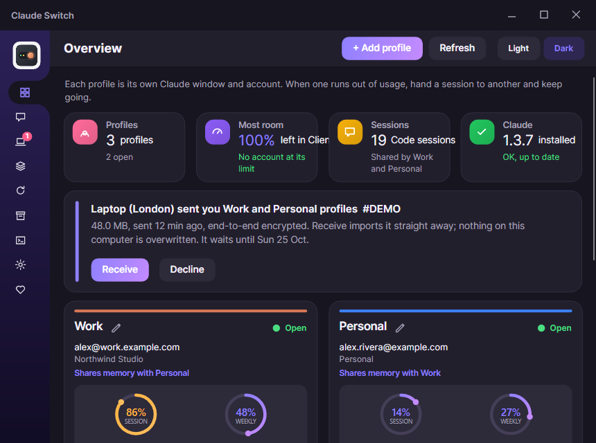</td></tr></table>

## When something looks wrong

- **"X and Y have swapped accounts".** A sign-in link opened in the wrong window. Press **Swap names**; nobody signs in again.
- **"X has no account yet".** Press **Sign in to X**, or **Remove** it if you don't need it.
- **"X and Y use the same account".** Press **Sign Y in again** and use a different account.
- **A transfer says Paused.** Check your connection and press **Resume** on the Linked computers page.
- **Usage looks old.** Copy the usage report in that Claude window and press **Paste report**.
- **Anything else.** Settings > **Diagnose…**, then [report an issue](https://github.com/Ngoni-Sama/claude-switch/issues) with the report.

For scripts: `ClaudeSwitch --list`, `--open Work`, `--diagnose`, `--check-update`, `--version`.

---
Screenshots use made-up demo data. Claude Switch is unofficial and not affiliated with Anthropic.
