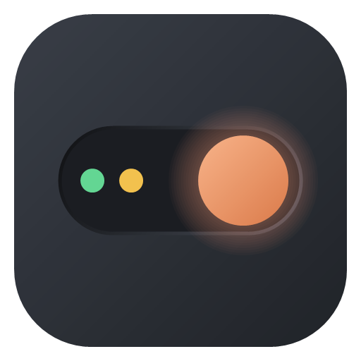

<p align="center">
  
</p>

<h1 align="center">Claude Switch</h1>

<p align="center">
  <b>Run several Claude Desktop accounts side by side, e.g. Work and Personal.</b><br>
  See every account's usage and reset times, and hand a session to another account when one runs out.
</p>

<p align="center">
  <a href="https://github.com/Ngoni-Sama/claude-switch/releases/latest"></a>
  <a href="https://github.com/Ngoni-Sama/claude-switch/actions/workflows/ci.yml"></a>
  
  <a href="LICENSE"></a>
  <a href="https://support-ngonie.vercel.app"></a>
</p>

<p align="center">
  
</p>

<p align="center">
  <a href="https://ngoni-sama.github.io/claude-switch/#video"><b>Watch the 40-second tour</b></a> &nbsp;&middot;&nbsp;
  <a href="MANUAL.md"><b>Manual</b></a> &nbsp;&middot;&nbsp;
  <a href="docs/assets/screens/dashboard-dark.png">Dark theme</a> &nbsp;&middot;&nbsp;
  <a href="https://ngoni-sama.github.io/claude-switch/">Website</a>
</p>

> **Unofficial.** Claude Switch is an independent open-source project, not made or endorsed by Anthropic.
> It doesn't modify Claude; it opens the Claude app you installed with a separate data folder per profile.

## Why

The Claude desktop app signs in to one account at a time. If you have a work account and a personal one,
you sign out and in, and you lose your place. Claude Switch gives each account its own window, all open
at once, and adds what you need to juggle them:

- **One window per account.** Each profile has its own sign-in, chat history, settings and Claude Code memory. Launch them from the app, its tray icon, or the Start menu / Launchpad / app menu.
- **Usage at a glance.** Session and weekly limits for every account, with **reset times** worded like Claude's own panel, e.g. *Resets in 1 hr 37 min*. 0% means all available; 100% means used up. Copy Claude's usage report and the card updates instantly with live numbers.
- **Keep working when one account runs out.** Hand a Claude Code session to another account with *Continue in Personal →*. It copies the conversation; the original stays put.
- **Unify mode: two accounts, one memory.** Let profiles share one set of project notes, instructions and conversations. When an account runs out of usage, open the other and carry on from exactly where you left off: same projects, same memory, same chats. Sign-ins stay separate, and you can turn it off at any time.
- **Picks up where you left off.** When you start your computer, Claude Switch offers to reopen the profiles you had open last time, or start clean. It can remember your answer.
- **Fixes the sign-in mix-up.** A sign-in link can open in the wrong window and switch its account. Claude Switch spots it and offers **Swap names**. It also recovers sessions that seem to have vanished because they were filed under the other account.
- **Move to a new computer.** Export profiles (sessions, memory, settings) to one password-protected file and import them anywhere. Sign-ins are never exported.
- **Linked computers, anywhere in the world.** Turn it on and each computer gets an address like `CS-7KQ2M-9XD4T-PAW8R-ZH3NC-5VJE`. Link two computers once by address (another office, another country), then send profiles to each other any time. Transfers are end-to-end encrypted to the receiving computer, wait on a relay for up to a week so the other computer needn't be on, and are deleted once collected. Sign-ins never travel. You can [run your own relay](relay/README.md).
- **Claude Code in a terminal, per profile.** *More > Open Claude Code in a terminal* opens one already signed in as that profile. Turn on terminal commands to type `claude-work`, `claude-personal`, ... anywhere, and add folder rules so plain `claude` picks the right profile inside a project.
- **Copy MCP servers between profiles**, for both Claude Desktop and Claude Code. Set them up once; the target's config is backed up first.
- **A colour per profile** on its card and its launcher icon. Rename, recolour or duplicate a profile from its *More* menu; mark profiles to open whenever Claude Switch starts.
- **Keeps Claude current.** Shows every installed copy of Claude and its version, moves a window stuck on an old copy onto the current one, and removes stale copies (even ones that lost their own uninstaller).
- **Diagnose.** One report covering where each profile's data really lives, which copy of Claude each window runs, sign-in state, versions and launchers, with the fix for anything wrong. Emails are masked so you can paste it into an issue.
- **Keyboard shortcuts** (Windows): Ctrl+Alt+1 to 9 open or bring forward a profile; Ctrl+Alt+0 opens Claude Switch.
- **Finds existing setups.** `Claude-<Name>` folders made by shell aliases or scripts show up with an *Add it* button.
- **Updates itself**, safely: releases are signed, and an update is only installed if its signature and checksum match.
- **A command line** for scripts: `ClaudeSwitch --list`, `--open Work`, `--diagnose`, `--check-update`.
- **Light and dark** flat tile design with ring gauges for usage, keyboard friendly, readable contrast.

## Install

| | One step | Or download |
|---|---|---|
| **Windows 10/11** | `irm https://raw.githubusercontent.com/Ngoni-Sama/claude-switch/main/install.ps1 \| iex` | [Setup (.exe)](https://github.com/Ngoni-Sama/claude-switch/releases/latest) or the portable zip |
| **macOS 12+** | `curl -fsSL https://raw.githubusercontent.com/Ngoni-Sama/claude-switch/main/install.sh \| bash` | [.dmg for Apple silicon or Intel](https://github.com/Ngoni-Sama/claude-switch/releases/latest) |
| **Linux** (Ubuntu/Debian) | `curl -fsSL https://raw.githubusercontent.com/Ngoni-Sama/claude-switch/main/install.sh \| bash` | [.deb or .tar.gz](https://github.com/Ngoni-Sama/claude-switch/releases/latest) |

You need [Claude Desktop](https://claude.ai/download) installed. On Linux that's Anthropic's
[official beta for Ubuntu/Debian](https://code.claude.com/docs/en/desktop-linux).

Nothing else to install: each download is a single self-contained app, and no admin rights are needed.

<details>
<summary><b>First-launch warnings (unsigned builds)</b></summary>

New open-source projects aren't code-signed yet, so your OS may ask once:

- **Windows:** *"Windows protected your PC"* → **More info** → **Run anyway**. The one-step installer avoids this. The installed app never shows it.
- **macOS:** *"can't be opened because Apple cannot check it"* → right-click the app → **Open** → **Open**. Only the first time.

Free code signing through the [SignPath Foundation](https://signpath.org) is planned so these go away.
</details>

## Manual

Step-by-step, with a screenshot of every page: **[MANUAL.md](MANUAL.md)**, or [on the website](https://ngoni-sama.github.io/claude-switch/manual.html).

<table>
<tr><td width="33%" align="center"><a href="MANUAL.md#overview"></a><br><sub><b>Overview</b></sub></td><td width="33%" align="center"><a href="MANUAL.md#add-a-profile-and-sign-in"></a><br><sub><b>Add a profile and sign in</b></sub></td><td width="33%" align="center"><a href="MANUAL.md#sessions"></a><br><sub><b>Sessions</b></sub></td></tr>
<tr><td width="33%" align="center"><a href="MANUAL.md#linked-computers"></a><br><sub><b>Linked computers</b></sub></td><td width="33%" align="center"><a href="MANUAL.md#shared-memory"></a><br><sub><b>Shared memory</b></sub></td><td width="33%" align="center"><a href="MANUAL.md#updates"></a><br><sub><b>Updates</b></sub></td></tr>
<tr><td width="33%" align="center"><a href="MANUAL.md#backup--move"></a><br><sub><b>Backup &amp; move</b></sub></td><td width="33%" align="center"><a href="MANUAL.md#terminal"></a><br><sub><b>Terminal</b></sub></td><td width="33%" align="center"><a href="MANUAL.md#small-screens-light-and-dark"></a><br><sub><b>Small screens, light and dark</b></sub></td></tr>
</table>

## How to use

1. Open **Claude Switch**. Name the account Claude is already signed into (e.g. *Personal*), then your others (e.g. *Work*).
2. Each new profile opens its own Claude window straight away; sign in there with that account. Each profile needs its own account (Claude Switch tells you if two share one), and signs in once.
3. That's it: each profile has a launcher (*Claude (Work)*), and the tray icon lists them all.

**Live usage numbers.** Claude only logs usage now and then. For exact numbers, copy the usage report in a
Claude window (it starts with *"Claude Code usage report"*). Claude Switch notices and updates that card.
It only ever reacts to that text; nothing else you copy is read or kept.

**When an account runs out.** Two ways, depending on how closely the accounts work together:

- *One session at a time:* find it under **Sessions** and click **Continue in …**. The conversation is copied; the original stays where it is.
- *Both accounts as one (unify mode):* on the dashboard, **Shared memory → Turn on sharing**, pick the profiles, and close their Claude windows while it sets up. From then on they share every project's memory, instructions and conversations, so when one hits its limit you just open the other and keep going. The at-limit banner offers **Carry on in …** for exactly this.

Check your company's rules before putting work into a personal account, and Anthropic's terms for your plans.

<details>
<summary><b>What unify mode actually shares</b></summary>

Each profile's `projects/` folder inside its Claude Code store becomes a link to one shared folder, so the
sharing is real rather than copied back and forth:

```
<profile A config>/projects ─┐
                             ├─→  <Claude Switch>/shared/projects
<profile B config>/projects ─┘
```

That folder is where Claude Code keeps, per project: `memory/*.md` (what Claude remembers), `CLAUDE.md`
(your instructions) and each conversation's transcript. Claude lists conversations per account, so each
account also gets its own small record pointing at the shared transcript; those are kept in step
automatically.

**Not shared:** sign-ins, and each profile's own account identity (`.claude.json`).

Turning sharing off gives every profile its own copy back, and the folder each had before linking is kept
as `projects.before-unify-<date>`. Nothing is deleted.
</details>

## How it works

Claude Desktop is an Electron app. Electron keeps one running copy per *data folder*, so Claude Switch
opens Claude with `--user-data-dir=<folder>`, one folder per profile, next to Claude's own:

| | Windows | macOS | Linux |
|---|---|---|---|
| Default profile | `%APPDATA%\Claude` | `~/Library/Application Support/Claude` | `~/.config/Claude` |
| Other profiles | `%APPDATA%\Claude-<Name>` | `…/Application Support/Claude-<Name>` | `~/.config/Claude-<Name>` |

Usage and reset times come from Claude's own local files: its usage log, the limit notices in Claude Code
transcripts, and usage reports you copy. Claude Switch never reads or sends your sign-in. On its own it makes one network request: a daily check
for its own updates on GitHub, which you can turn off in Settings. If you turn on Linked computers, it also
talks to the relay (every few minutes, and when you send or receive); everything it uploads there is
encrypted on your computer first.

### Works alongside

- **[claude-account-switcher](https://github.com/SmelterLabs/claude-account-switcher)**, which bills a Code session
  to another of your subscriptions through a local relay. If it's installed, Claude Switch shows whether the relay
  is running and each account's live usage, from the relay's status file only. It never touches that tool's tokens.

## Support

I'd like to dedicate more of my time building new tools and working on open source projects. Your donation
will give me time to focus on developing new tools for the open-source community.

<p><a href="https://support-ngonie.vercel.app"><b>Buy me a coffee</b></a> &nbsp;(card, EcoCash or OneMoney through Pesepay)</p>

Starring the repo and sharing it helps just as much.

## Contributing

Contributions are welcome: bug fixes, features, translations, packaging. See [CONTRIBUTING.md](CONTRIBUTING.md).
`main` is protected; open a pull request from your own branch or fork and it's merged after review.

```bash
git clone https://github.com/Ngoni-Sama/claude-switch.git
cd claude-switch
dotnet run --project src/ClaudeSwitch          # needs the .NET 10 SDK
dotnet test tests/ClaudeSwitch.Tests
```

## License

[MIT](LICENSE) © 2026 **Ngoni Maphosa** ([@Ngoni-Sama](https://github.com/Ngoni-Sama)).
If you build on Claude Switch, keep the copyright notice and give credit. See [NOTICE](NOTICE) for third-party credits.

"Claude" is a trademark of Anthropic, PBC. This project is not affiliated with Anthropic.
